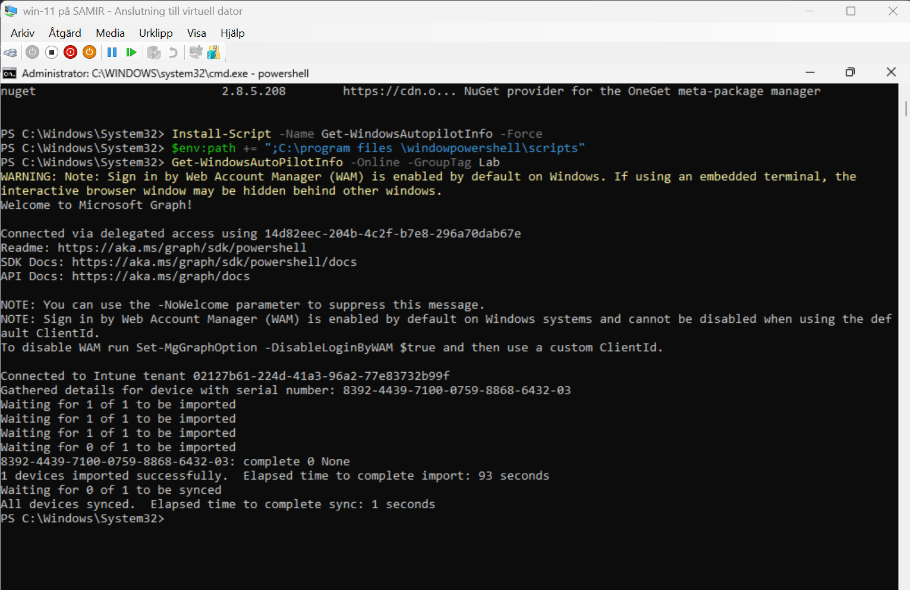
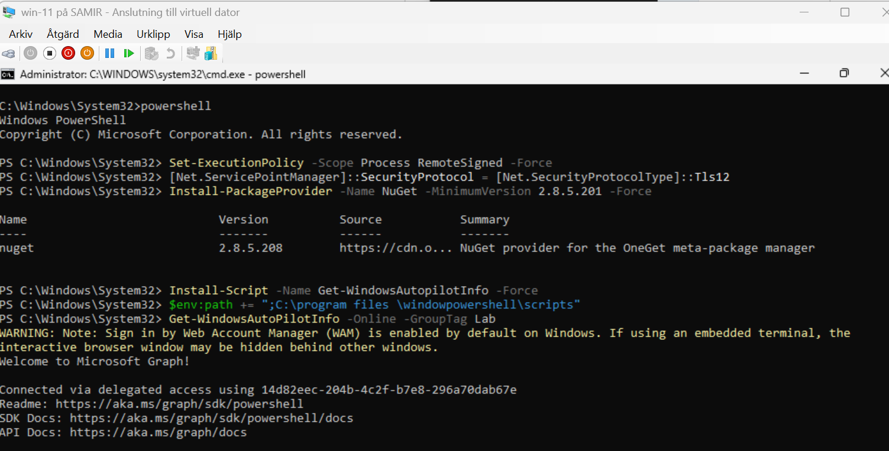
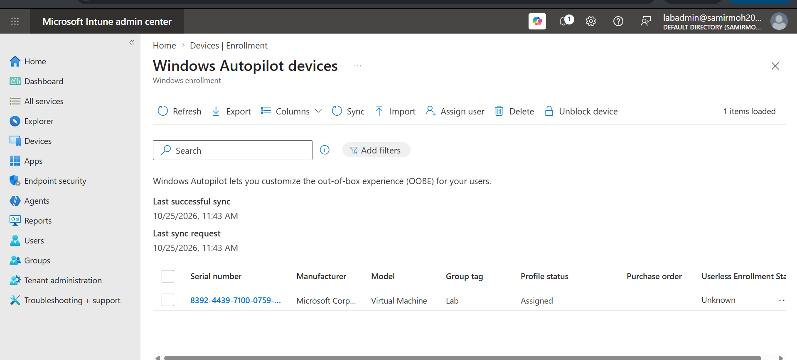
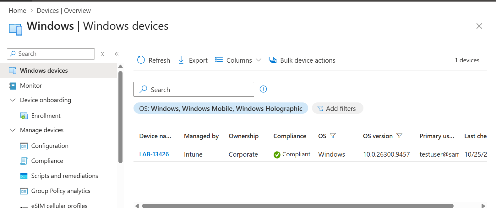

# 02 – Windows Autopilot

**Goal:** user-driven Autopilot deployment, Microsoft Entra joined.

## 1. Prepare the VM (Hyper-V)
Windows 11 requires TPM 2.0, Secure Boot and 4 GB RAM.

```powershell
$vm = "win-11"
Set-VMMemory    -VMName $vm -DynamicMemoryEnabled $false -StartupBytes 4GB
Set-VMProcessor -VMName $vm -Count 2
Set-VMFirmware  -VMName $vm -EnableSecureBoot On -SecureBootTemplate MicrosoftWindows
Set-VMKeyProtector -VMName $vm -NewLocalKeyProtector
Enable-VMTPM    -VMName $vm
```
TPM is only available on **Generation 2** VMs.


## 2. Upload the hardware hash
Install Windows and stop at the first OOBE screen. Press **Shift + F10** and run [`Get-AutopilotHash.ps1`](https://github.com/SamirMohamed24/intune-endpoint-management-lab/blob/main/scripts/Get-AutopilotHash.ps1):

```powershell
Set-ExecutionPolicy Bypass -Scope Process -Force
Install-Script -Name Get-WindowsAutopilotInfo -Force
Import-Module Microsoft.Graph.Authentication
Set-MgGraphOption -DisableLoginByWAM $true
Get-WindowsAutopilotInfo -Online -GroupTag "Lab"
```

Sign in as **labadmin** (work or school account) and grant consent.




## 3. Dynamic device group
`SG-Autopilot-Devices-Lab` – Security, Dynamic Device:

```
(device.devicePhysicalIds -any (_ -eq "[OrderID]:Lab"))
```

The group tag `Lab` set at upload puts the device in the group automatically.


## 4. Deployment profile
*Devices → Windows → Enrollment → Deployment profiles → Create → Windows PC*

| Setting | Value |
|---|---|
| Name | AutopilotLabProfile |
| Deployment mode | User-driven |
| Join to Microsoft Entra ID as | Microsoft Entra joined |
| License terms / Privacy / Change account options | Hide |
| User account type | Standard |
| Device name template | `LAB-%RAND:5%` |
| Assignment | SG-Autopilot-Devices-Lab |

Wait for **Profile status = Assigned** under *Windows Autopilot devices* before restarting the VM.



## 5. Deploy
In OOBE: `shutdown /r /t 0`, then sign in with the test user.


## 6. Verify
```
dsregcmd /status
hostname
```
- `AzureAdJoined : YES`, `DomainJoined : NO`
- Device name `LAB-xxxxx` (from the template)
- *Settings → Accounts → Access work or school* shows an **Info** button = enrolled in Intune
- Intune: *Devices → Windows* shows the device, **Ownership: Corporate**, **Enrollment profile: AutopilotLabProfile**




