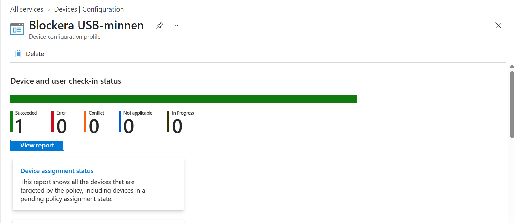
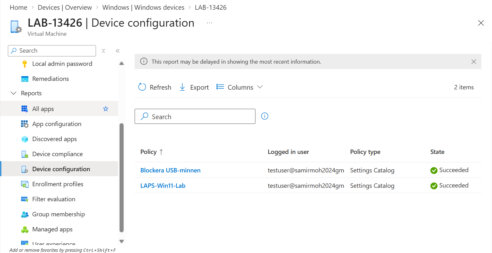
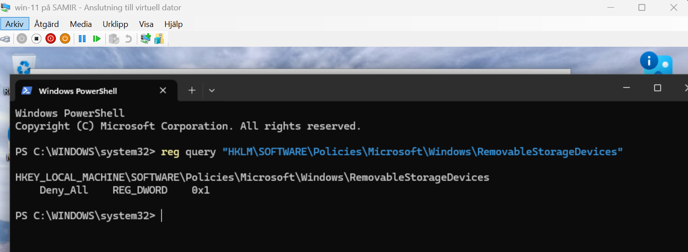
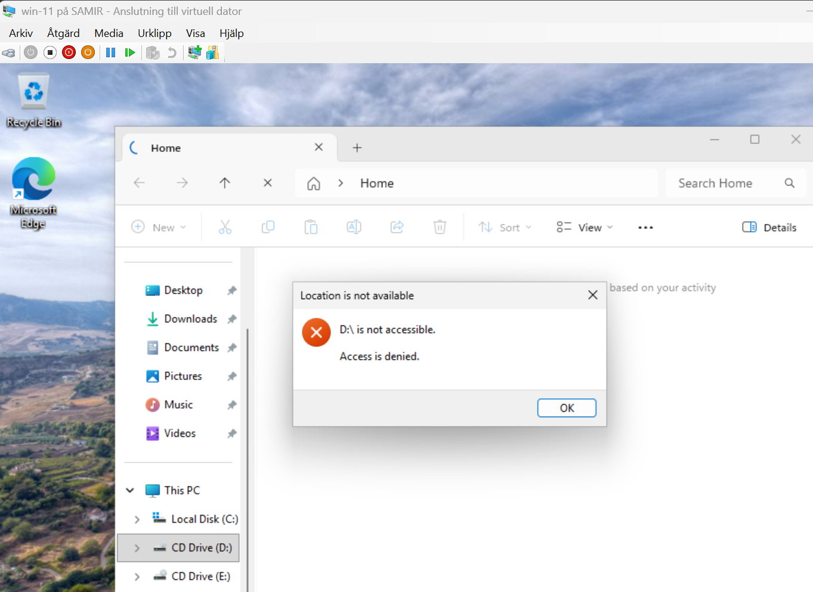

# 03 – Device configuration: block removable storage

**Goal:** block USB and CD/DVD storage with a Settings catalog policy and verify it on the client.

## 1. Policy
*Devices → Configuration → Create → Windows 10 and later → Settings catalog*

| Setting | Value |
|---|---|
| Name | Blockera USB-minnen |
| Administrative Templates → System → Removable Storage Access → **All Removable Storage classes: Deny all access** | Enabled |
| Assignment | SG-Autopilot-Devices-Lab |


## 2. Verify in Intune
*Policy → Device and user check-in status* → **Succeeded: 1**




## 3. Verify on the client
```powershell
reg query "HKLM\SOFTWARE\Policies\Microsoft\Windows\RemovableStorageDevices"
```



Hyper-V has no USB pass-through, so I tested with a virtual DVD drive (*Media → DVD Drive → Insert disk*). The policy also covers CD/DVD.

Result: **"D:\ is not accessible. Access is denied."**


