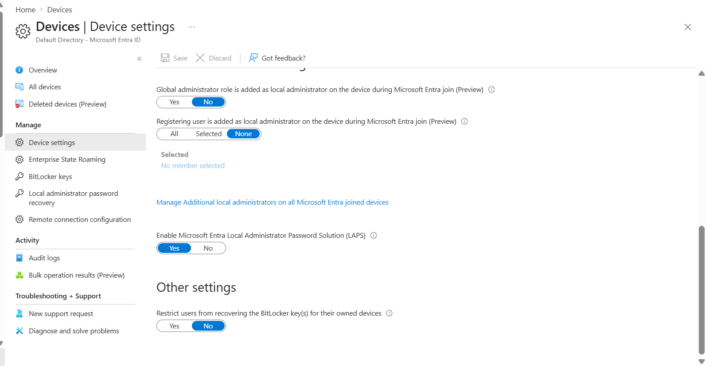
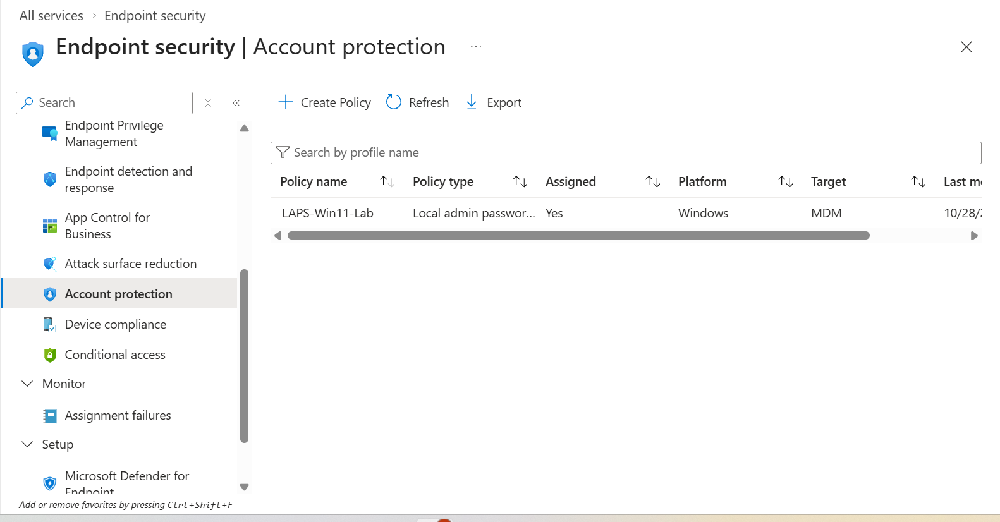
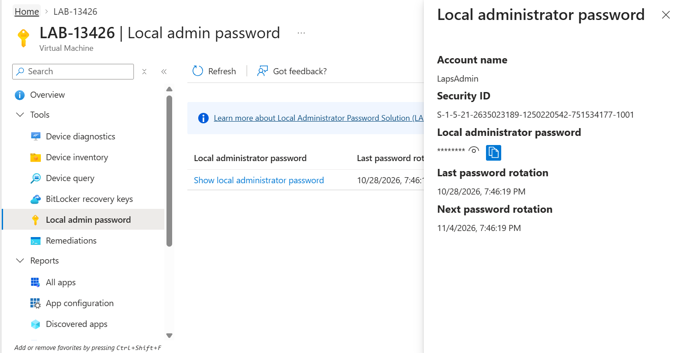

# 04 – Windows LAPS

**Goal:** a unique, rotating local admin password per device, backed up to Entra ID.

## 1. Enable LAPS in Entra
*Entra → Devices → Device settings → Enable Microsoft Entra LAPS = Yes*



## 2. Policy
*Endpoint security → Account protection → Create → Windows → Local admin password solution (Windows LAPS)*

| Setting | Value |
|---|---|
| Backup directory | Azure AD only |
| Password age days | 7 |
| Password complexity | Upper + lower + numbers + special |
| Password length | 14 |
| Post-authentication actions | Reset password and log off |
| Post-authentication reset delay | 1 hour |
| Automatic account management | Enabled – manage a new custom account |
| Account name | `LapsAdmin` (no random suffix), enabled |
| Assignment | SG-Autopilot-Devices-Lab |



## 3. Retrieve and use the password
*Devices → LAB-13426 → Local admin password → Show local administrator password*

Use it in the UAC prompt: user `.\LapsAdmin`.

```powershell
whoami   # lab-13426\lapsadmin
```



## Windows 10 vs Windows 11
On the Windows 10 VM, Intune showed the account **Administratör** (SID ending in **-500**) instead of LapsAdmin.

**Automatic account management requires Windows 11 24H2 or later.** On Windows 10, LAPS falls back to the built-in Administrator account, which is disabled by default. After the device was upgraded to Windows 11 (lab 10), LapsAdmin is created as on the first VM.

Workaround while on Windows 10: sign in to UAC with a Global Admin (`AzureAD\labadmin@…`), or enable the built-in Administrator with a Settings catalog policy (*Local Policies Security Options → Accounts Enable Administrator Account Status*).
