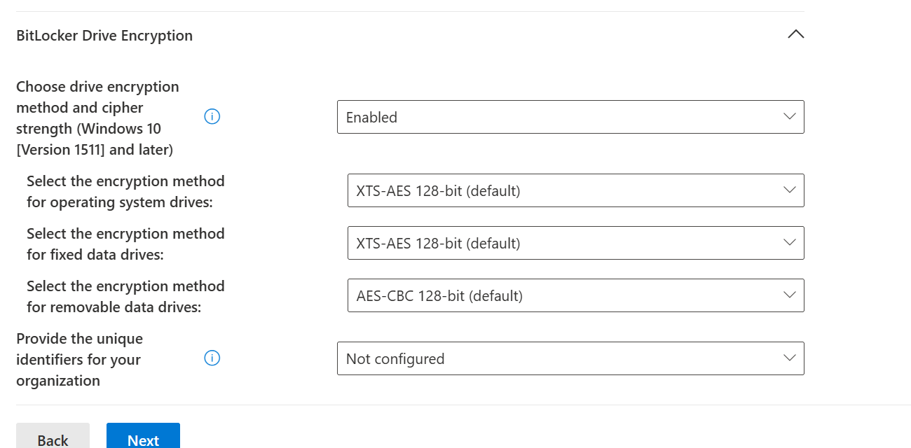
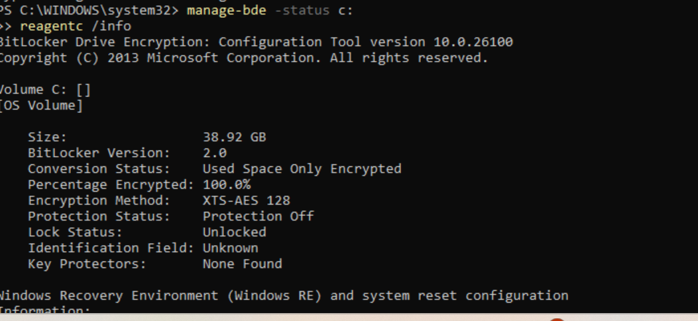
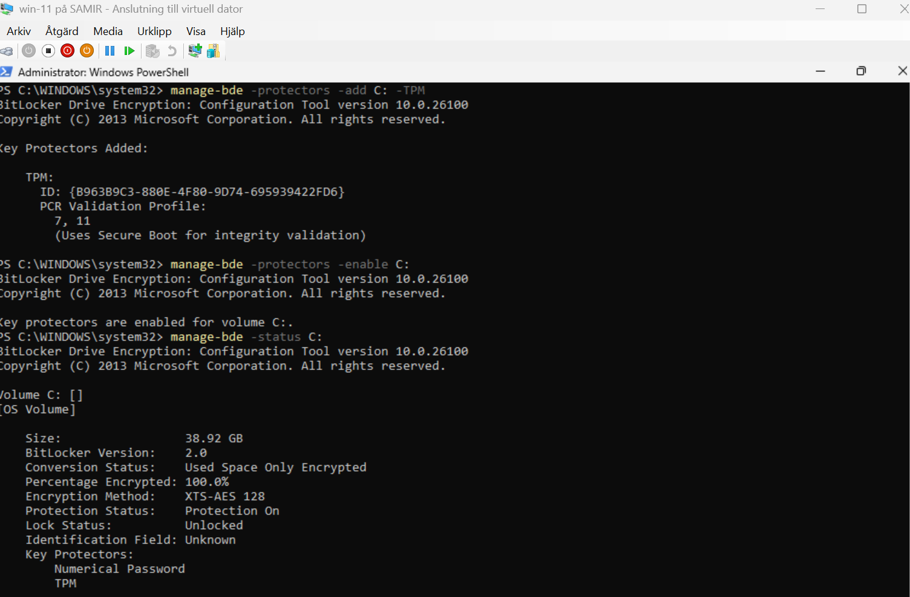
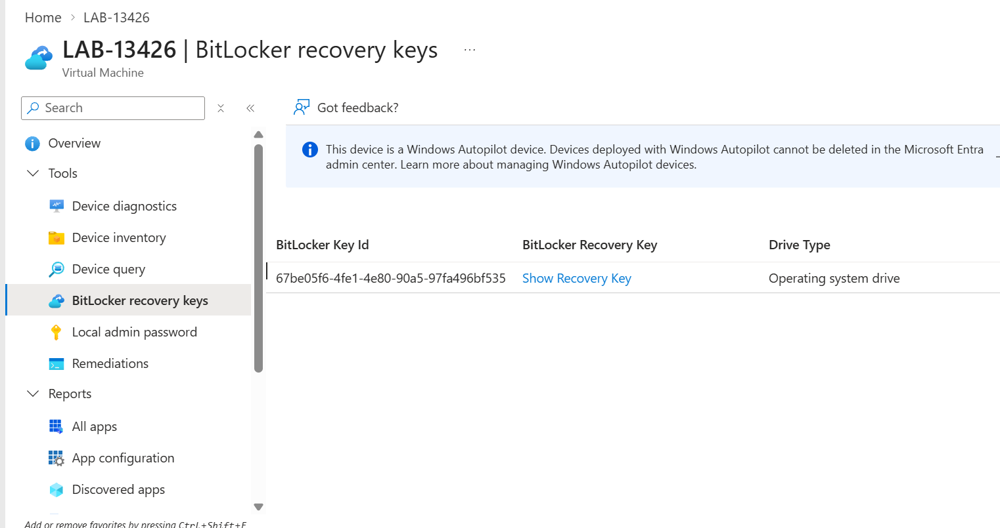

# 05 – BitLocker

**Goal:** silent BitLocker encryption with TPM, recovery key escrowed to Entra ID, and a recovery test.

## 1. Policy
*Endpoint security → Disk encryption → Create → Windows → BitLocker*

| Setting | Value |
|---|---|
| Require device encryption | Enabled |
| Allow warning for other disk encryption | Disabled (required for silent encryption) |
| Allow standard user encryption | Enabled |
| Configure recovery password rotation | Refresh on for Entra joined devices |
| Encryption type for OS drives | Used space only |
| Require additional authentication at startup | Enabled – TPM allowed, startup key/PIN **Do not allow** |
| Allow BitLocker without a compatible TPM | False |
| OS drive recovery | Enabled – 48-digit password allowed, hide recovery options, save to AD DS, **do not enable BitLocker until recovery information is stored** |
| Assignment | SG-Autopilot-Devices-Lab |

Silent encryption only works when the TPM alone unlocks the disk. Any required PIN or startup key blocks it.



## 2. Check encryption status

```powershell
manage-bde -status C:
```

| Field | Value |
|---|---|
| Conversion status | Used space only encrypted, 100 % |
| Protection status | **Protection Off** |
| Key protectors | **None found** |

If the disk is encrypted but has no key protectors, add them and back up the recovery key:



## 3. Add protectors and back up the key – [`Fix-BitLockerActivation.ps1`](https://github.com/SamirMohamed24/intune-endpoint-management-lab/blob/main/scripts/Fix-BitLockerActivation.ps1)
```powershell
manage-bde -protectors -add C: -RecoveryPassword
$kp = (Get-BitLockerVolume -MountPoint C:).KeyProtector | Where-Object KeyProtectorType -eq RecoveryPassword
BackupToAAD-BitLockerKeyProtector -MountPoint C: -KeyProtectorId $kp.KeyProtectorId
manage-bde -protectors -add C: -TPM
manage-bde -protectors -enable C:
```
The key is backed up to Entra **before** protection is turned on.

Result: **Protection On**, protectors **TPM + Numerical Password**, key visible under *Devices → LAB-13426 → BitLocker recovery keys*.




## 4. Recovery test
Take a Hyper-V checkpoint first.

```powershell
manage-bde -forcerecovery C:
shutdown /r /t 0
```
The VM boots to the BitLocker recovery screen. Match the Key ID, enter the 48-digit key from Intune, Windows starts.


