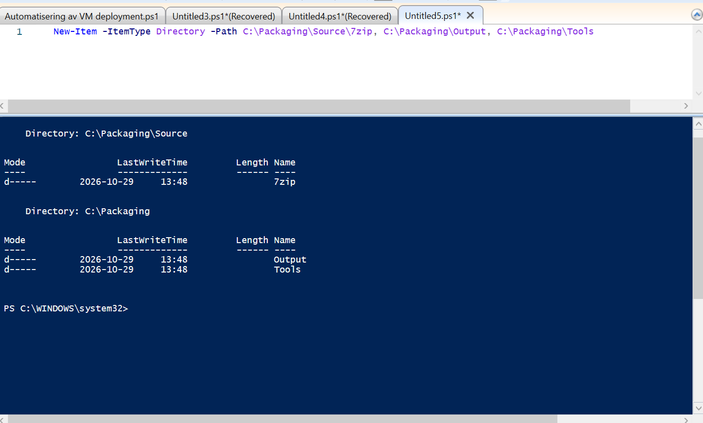
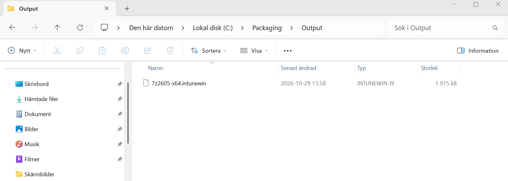
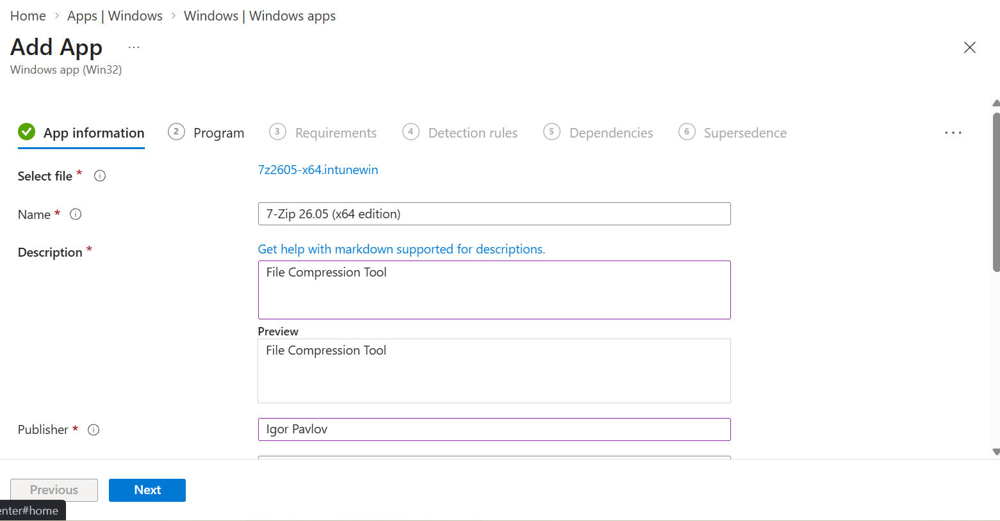
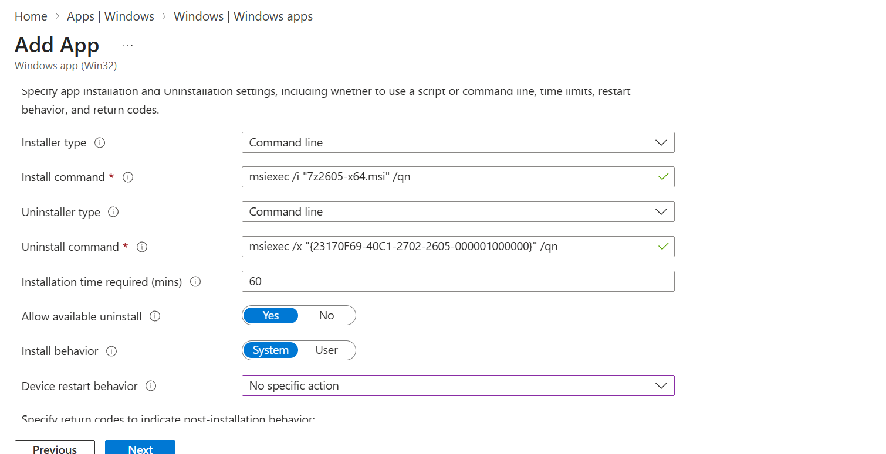
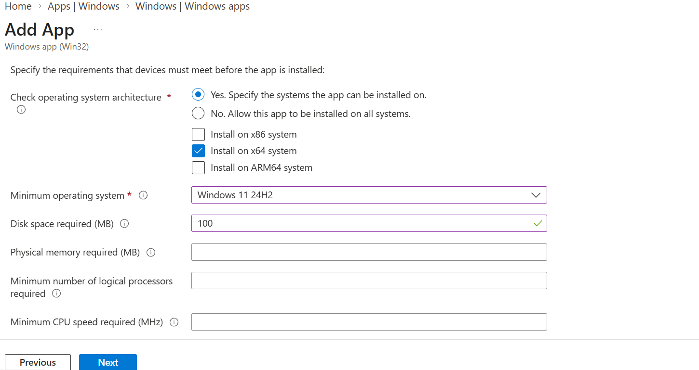
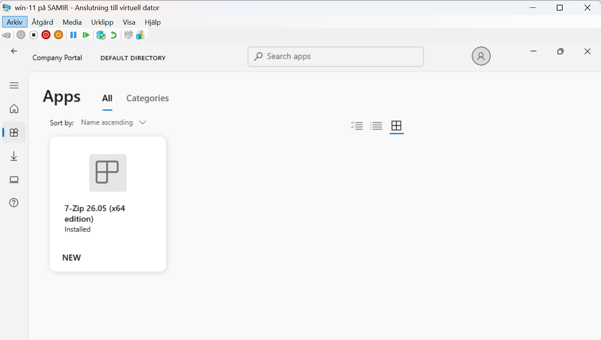
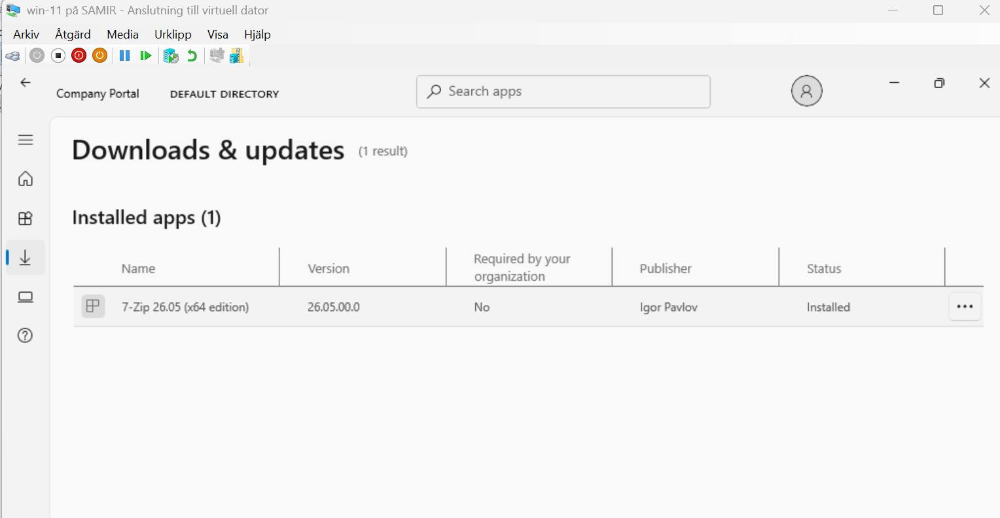

# 06 – Win32 app: 7-Zip (MSI)

**Goal:** package an MSI as a Win32 app, deploy it, and compare Required and Available assignments.

## 1. Packaging (on the admin PC, not the clients)
```
C:\Packaging
├─ Source\7zip\7z2605-x64.msi
├─ Output\
└─ Tools\IntuneWinAppUtil.exe
```
One source folder per app and version: IntuneWinAppUtil packs **everything** in the folder.



```powershell
.\IntuneWinAppUtil.exe -c C:\Packaging\Source\7zip -s 7z2605-x64.msi -o C:\Packaging\Output -q
```
The `.intunewin` file is the source zipped, encrypted (key stored in Intune) and hashed, plus metadata such as the MSI product code.



## 2. App in Intune
*Apps → Windows → Create → Windows app (Win32)*

| Tab | Setting |
|---|---|
| Program | `msiexec /i "7z2605-x64.msi" /qn` / `msiexec /x "{23170F69-40C1-2702-2605-000001000000}" /qn` (filled automatically for MSI) |
| Install behavior | System |
| Return codes | 0, 1707 success · 3010 soft reboot · 1641 hard reboot · 1618 retry |
| Requirements | x64 only, minimum Windows 11 24H2, 100 MB free disk |
| Detection | MSI product code |
| Assignment | Required → SG-Autopilot-Devices-Lab |






## 3. Required vs Available
| | Required | Available for enrolled devices |
|---|---|---|
| Who decides | IT – installs automatically | The user, from Company Portal |
| User can uninstall | No | Yes (if *Allow available uninstall*) |
| If removed | Intune reinstalls it | Stays removed |
| Typical apps | VPN, security, Office | Optional tools |

I switched 7-Zip from Required (device group) to Available (user group). Company Portal then showed **Required by your organization: No** and enabled **Uninstall / Reinstall**. Assignment changes can take 15–30 minutes to reach the device.



