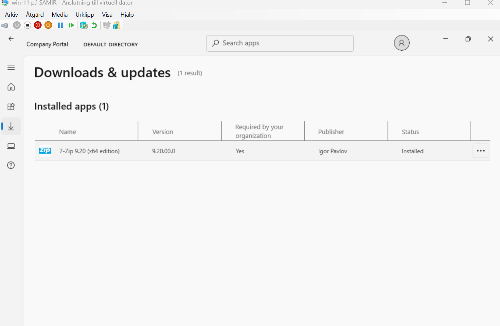
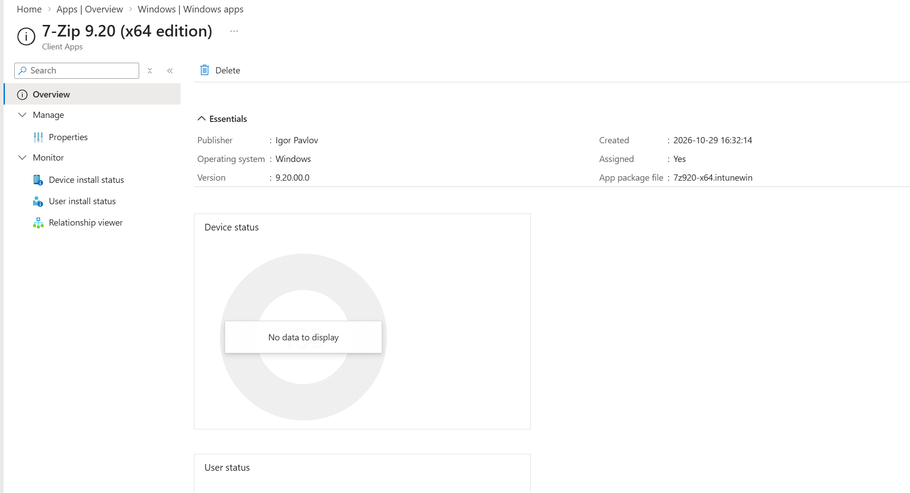
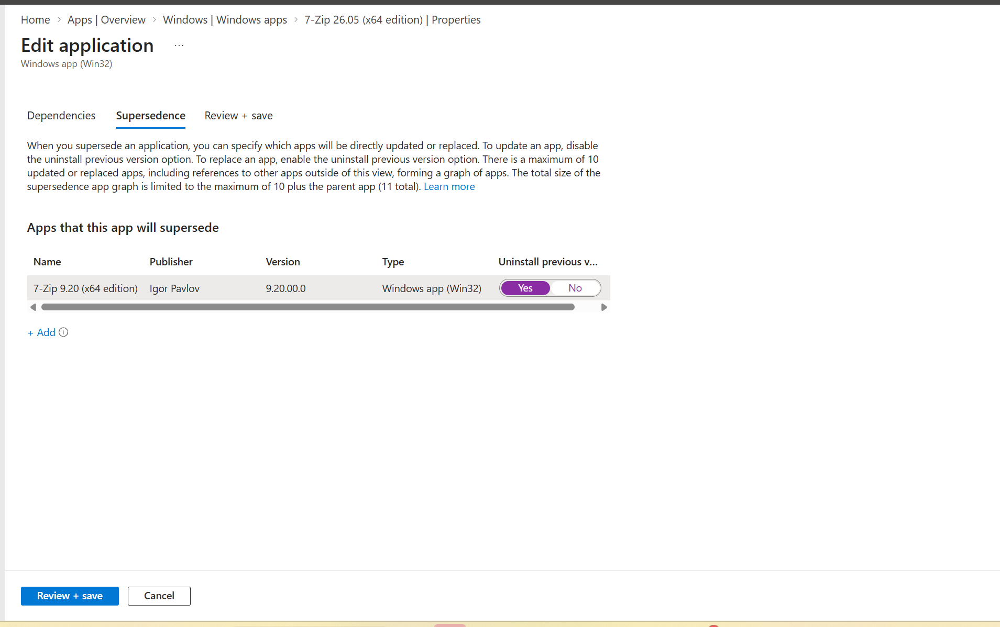
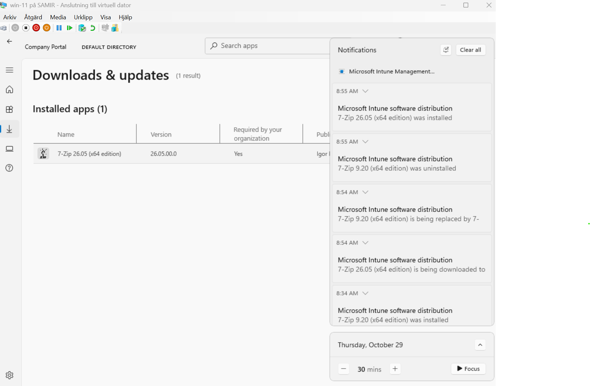
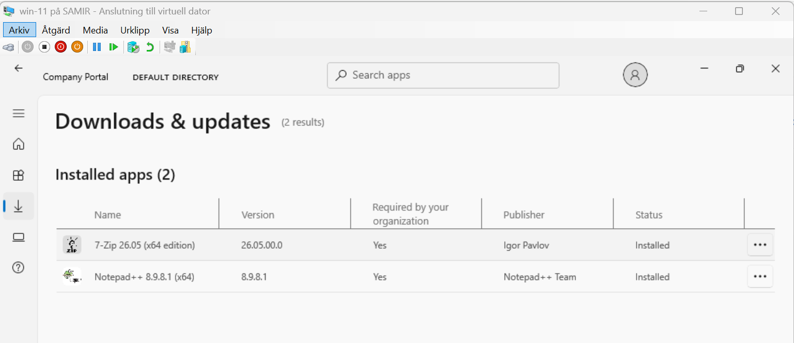

# 07 – Supersedence: 7-Zip 9.20 → 26.05

**Goal:** replace an old app version with a new one automatically.

## 1. Old version
Packaged `7z920-x64.msi` the same way (own source folder), deployed as **Required**. Its product code is different from 26.05 (`…-0920-…` vs `…-2605-…`), so each version has its own MSI detection rule.

## 2. Supersedence on the new app
*7-Zip 26.05 → Properties → Supersedence → Add 7-Zip 9.20*

- **Uninstall previous version: Yes**
- 26.05 assignment: **Required → SG-Autopilot-Devices-Lab** (supersedence only acts when the new app is targeted at the device)

| Uninstall previous version | Behaviour |
|---|---|
| Yes | Runs the old app's uninstall command, then installs the new one |
| No | Installs the new version on top (installer handles the upgrade) |

## 3. Result
Notification Center on the VM:
1. 7-Zip 26.05 is being downloaded
2. 7-Zip 9.20 is being replaced by 7-Zip 26.05
3. 7-Zip 9.20 was uninstalled
4. 7-Zip 26.05 was installed

## 4. Clean-up
Removed the assignment from 9.20 so no new device gets the old version. The app itself stays in Intune, because the supersedence relationship points to it (and it is the way back if a rollback is needed).
