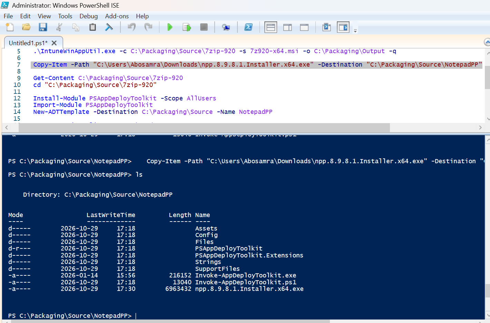
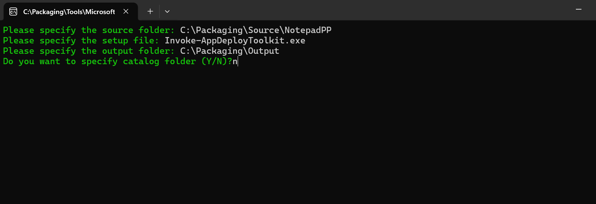
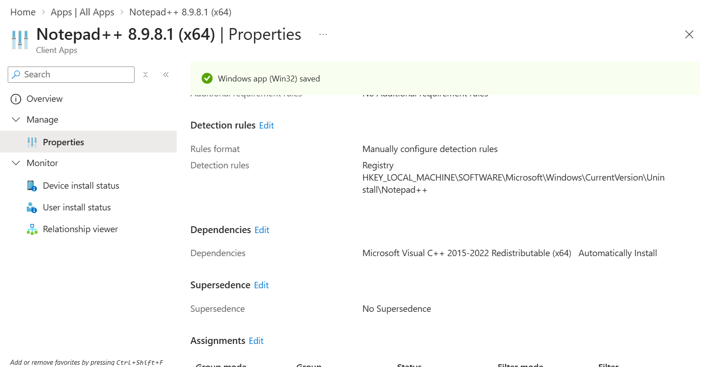
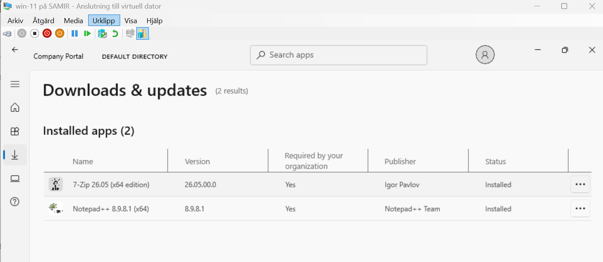
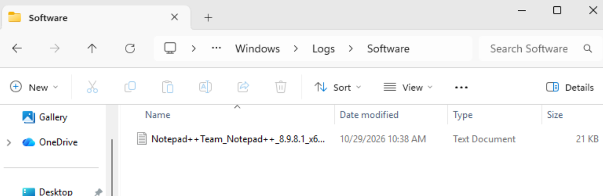

# 08 – PSAppDeployToolkit: Notepad++ (EXE)

**Goal:** package an EXE installer with PSADT v4 and deploy it with a hand-built detection rule.

## Why PSADT
| Without PSADT | With PSADT |
|---|---|
| Install fails if the app is open | Closes the app (or asks the user) first |
| No log | Log in `C:\Windows\Logs\Software` |
| Every package looks different | Same structure for every package |

## 1. Create the template
```powershell
Install-Module PSAppDeployToolkit -Scope AllUsers
Set-ExecutionPolicy RemoteSigned -Scope Process -Force
New-ADTTemplate -Destination C:\Packaging\Source -Name NotepadPP
```
Put `npp.8.9.8.1.Installer.x64.exe` in `NotepadPP\Files\`.




## 2. The script
Full script: [`Invoke-AppDeployToolkit.ps1`](https://github.com/SamirMohamed24/intune-endpoint-management-lab/blob/main/scripts/psadt-notepadpp/Invoke-AppDeployToolkit.ps1)

| Section | What it does |
|---|---|
| `$adtSession` | Vendor, name, version 8.9.8.1, x64, processes to close: `notepad++` |
| Install | `Start-ADTProcess -FilePath 'npp.8.9.8.1.Installer.x64.exe' -ArgumentList '/S'` |
| Post-install | Removes the built-in auto-updater so Intune controls versions |
| Uninstall | Runs `uninstall.exe /S`, then waits until `notepad++.exe` is gone (NSIS uninstallers return before they finish) |

## 3. Test locally first
```powershell
.\Invoke-AppDeployToolkit.exe -DeploymentType Install -DeployMode Silent
.\Invoke-AppDeployToolkit.exe -DeploymentType Uninstall -DeployMode Silent
```
Tested uninstall with Notepad++ **open**: PSADT closed it and uninstalled.


## 4. Find the detection rule
```powershell
Get-ItemProperty "HKLM:\SOFTWARE\Microsoft\Windows\CurrentVersion\Uninstall\Notepad++" | Select DisplayName, DisplayVersion
# Notepad++ (64-bit x64)   8.9.8.1
```

## 5. Package and upload
```powershell
.\IntuneWinAppUtil.exe -c C:\Packaging\Source\NotepadPP -s Invoke-AppDeployToolkit.exe -o C:\Packaging\Output -q
```
Renamed the output to `NotepadPP-8.9.8.1.intunewin` (every PSADT package is called `Invoke-AppDeployToolkit.intunewin`).



| Tab | Setting |
|---|---|
| Install | `Invoke-AppDeployToolkit.exe -DeploymentType Install -DeployMode Silent` |
| Uninstall | `Invoke-AppDeployToolkit.exe -DeploymentType Uninstall -DeployMode Silent` |
| Restart behavior | Determine behavior based on return codes |
| Requirements | x64, Windows 11 24H2 |
| Detection | Registry `HKLM\SOFTWARE\Microsoft\Windows\CurrentVersion\Uninstall\Notepad++`, value `DisplayVersion`, **version ≥ 8.9.8.1** |

Version comparison with *greater than or equal*: a newer version counts as installed, an older one gets upgraded.



## 6. Result
Installed via Intune. The PSADT log on the client (`C:\Windows\Logs\Software\`) shows it ran as **NT AUTHORITY\SYSTEM** in Silent mode with exit code 0.



