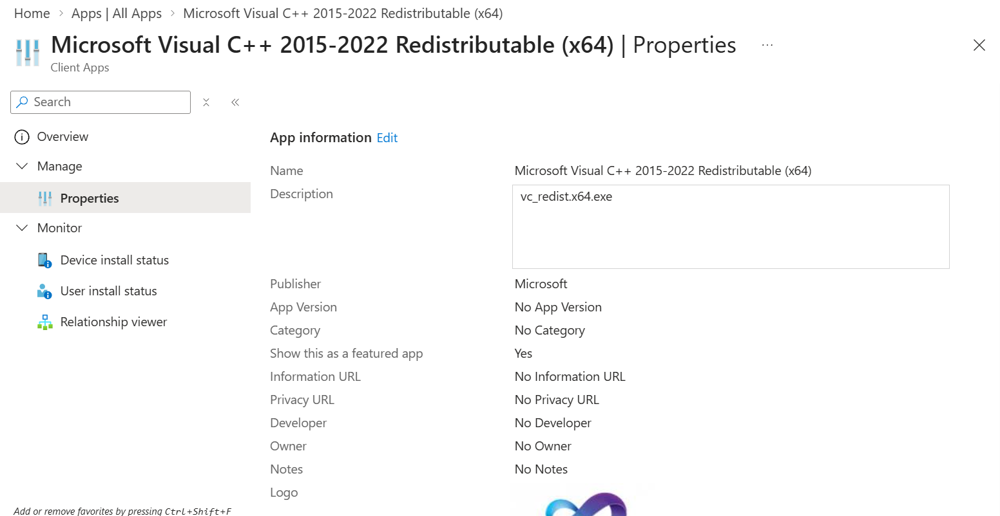
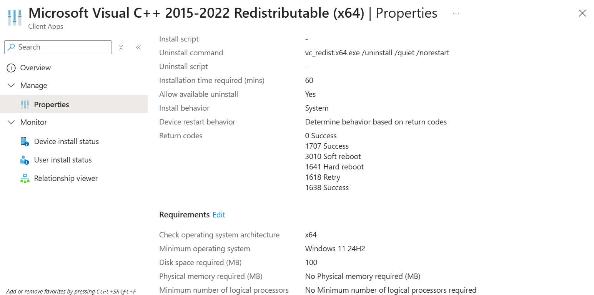
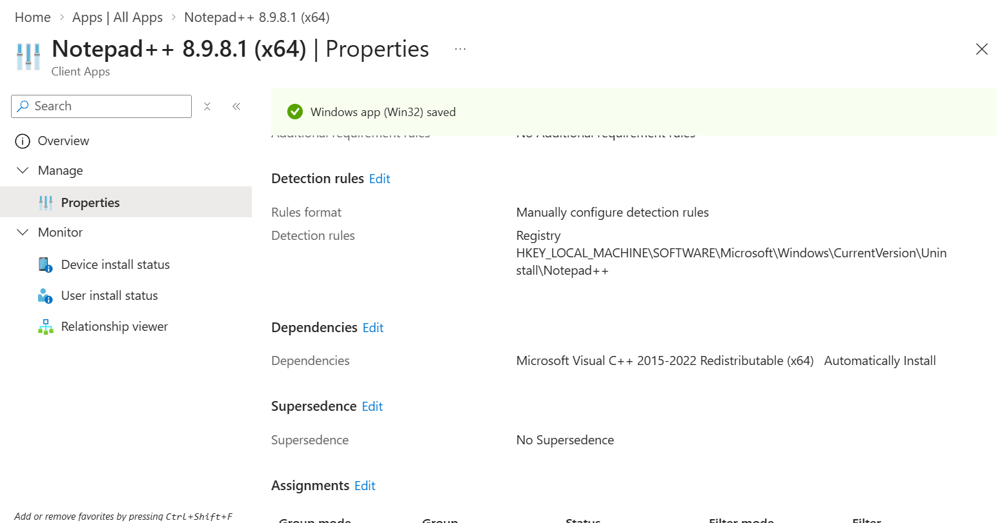
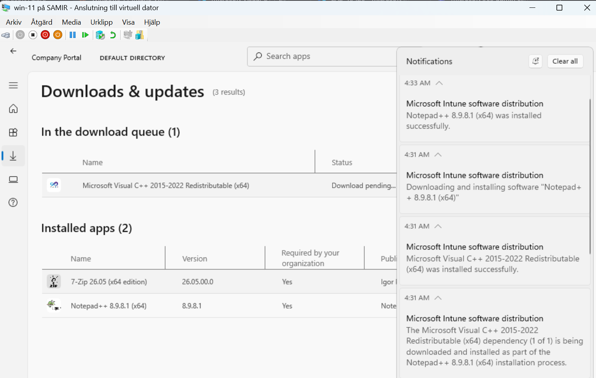

# 09 – Dependencies: VC++ Redistributable → Notepad++

**Goal:** make Intune install a prerequisite automatically before the main app.

Notepad++ does not really need VC++. The relationship was created to practise the mechanism. Real examples are CAD and engineering apps that fail with `VCRUNTIME140.dll was not found`.

## 1. VC++ package
Installer: `vc_redist.x64.exe` (aka.ms/vs/17/release/vc_redist.x64.exe)

| Tab | Setting |
|---|---|
| Install | `vc_redist.x64.exe /install /quiet /norestart` |
| Uninstall | `vc_redist.x64.exe /uninstall /quiet /norestart` |
| Return codes | 0 success, **1638 success** (newer/same version already installed) |
| Requirements | x64, Windows 11 24H2, no extra rules |
| Detection | Registry `HKLM\SOFTWARE\Microsoft\VisualStudio\14.0\VC\Runtimes\X64`, value `Installed`, integer **equals 1** |
| Assignment | **None** |

- Version comparison was not used: the stored version is `v14.44.35211.00`, and the leading **v** breaks Intune's version comparison.
- A dependency should have as few requirements as possible. If it is not applicable, the main app fails too.

## 2. Link the dependency
*Notepad++ → Properties → Dependencies → Add VC++* → **Automatically install: Yes**

## 3. Test
VC++ has no assignment of its own, so it can only reach the device as a dependency.

1. Removed every assignment from VC++.
2. Uninstalled both Notepad++ and VC++ from the VM.
3. Synced. Notepad++ (Required) was reinstalled, pulling VC++ in first.

Notification Center:
> "The Microsoft Visual C++ 2015-2022 Redistributable (x64) **dependency (1 of 1)** is being downloaded and installed as part of the Notepad++ 8.9.8.1 (x64) installation process."

## 4. Verify
- VC++ → *Device install status*: Installed, although it has no assignment
- Notepad++ → *Relationship viewer* / *Dependency status*
