# 10 – Windows Update: rings and Windows 10 → 11 upgrade

**Goal:** manage updates with rings and upgrade a Windows 10 device to Windows 11 through Intune.

## 1. Update ring (pilot)
*Devices → Windows updates → Update rings → Create profile*

| Setting | Pilot |
|---|---|
| Quality / feature update deferral | 0 / 0 days |
| Automatic update behavior | Auto install at maintenance time |
| Active hours | 08:00–17:00 |
| Option to pause updates | Disable |
| Notifications | Default |
| Deadline quality / feature | 2 / 2 days, grace period 1 day |
| Assignment | `SG-WU-Pilot` |

A production ring would use 7 days' quality deferral, assigned to **All devices** with **SG-WU-Pilot excluded**, so no device is in two rings.

On the client: *"Some settings are managed by your organization"*, pause greyed out, and a restart prompt with the deadline date.

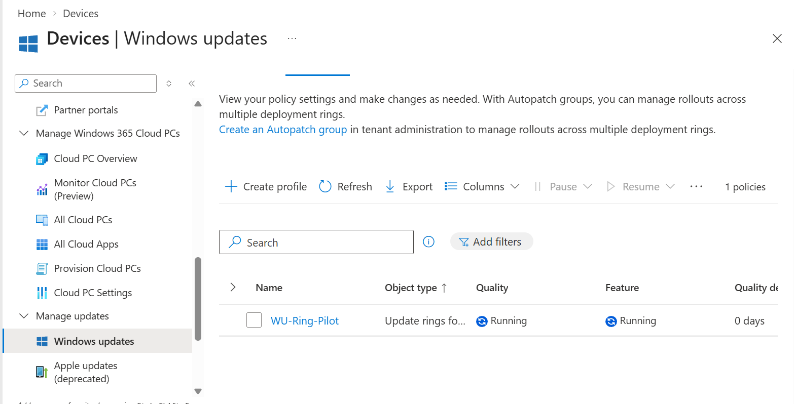
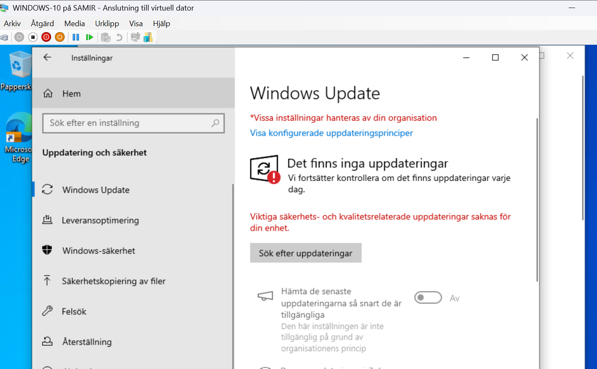

## 2. Prerequisites for feature updates
*Tenant administration → Connectors and tokens → Windows data*
- Enable features that require Windows diagnostic data: **On**
- Windows license verification: **On**

## 3. Second VM: Windows 10 22H2
Installed from the Media Creation Tool ISO (Pro edition), enrolled with Autopilot as **TestUser2** → `LAB-46792`, build **10.0.19045.3803**. The E5 license upgraded the edition to Enterprise.

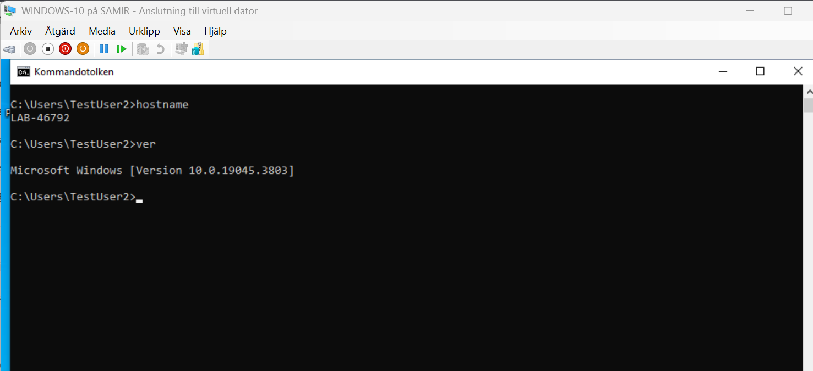
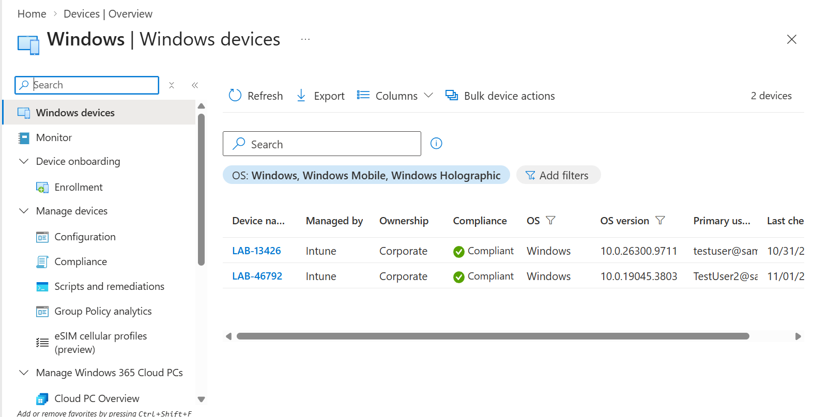

## 4. Feature update policy
*Windows updates → Feature updates → Create profile*

| Setting | Value |
|---|---|
| Name | FU-Win11-26H2-Upgrade |
| Feature update to deploy | Windows 11, version 26H2 |
| Rollout | Make update available as soon as possible |
| Assignment | `SG-WU-Win10-Upgrade` |

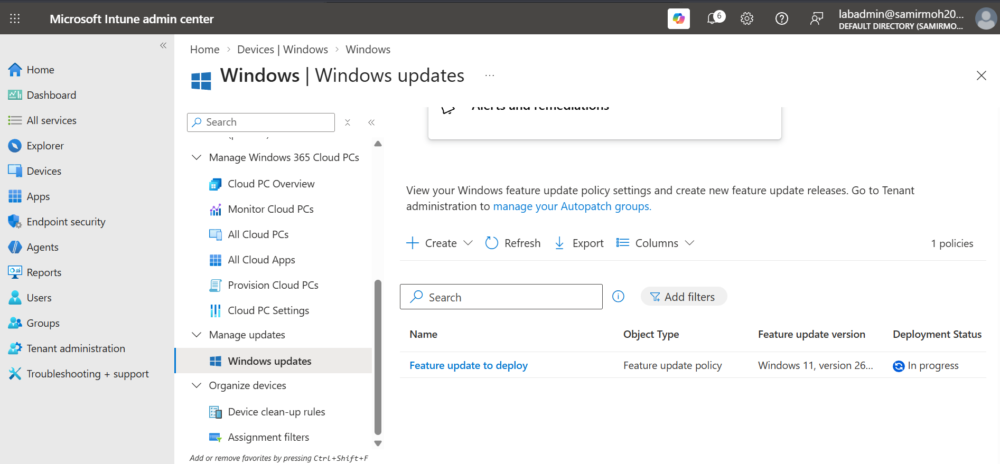
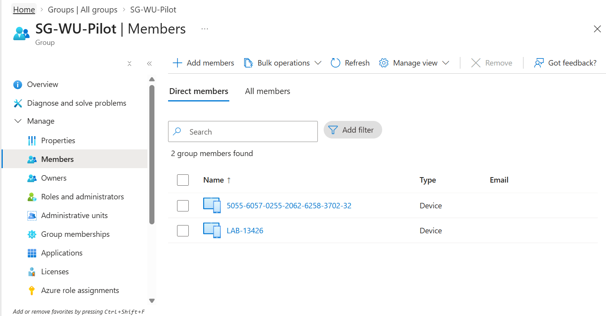
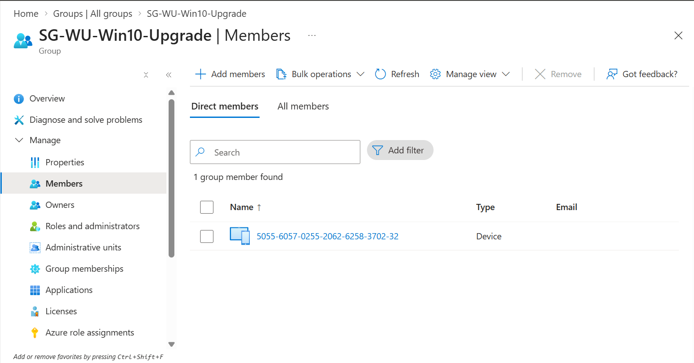

## 5. Prepare the VM for Windows 11
Windows 11 requires TPM 2.0, Secure Boot, 4 GB RAM and a 64 GB disk.

**Expand the disk on the Hyper-V host:**
```powershell
$vhd = (Get-VMHardDiskDrive -VMName "WINDOWS-10").Path
Resize-VHD -Path $vhd -SizeBytes 80GB
```
**Extend C: inside the VM:** [`Extend-CDrive.ps1`](https://github.com/SamirMohamed24/intune-endpoint-management-lab/blob/main/scripts/Extend-CDrive.ps1), then re-run the compatibility appraiser:
```powershell
schtasks /run /tn "\Microsoft\Windows\Application Experience\Microsoft Compatibility Appraiser"
```
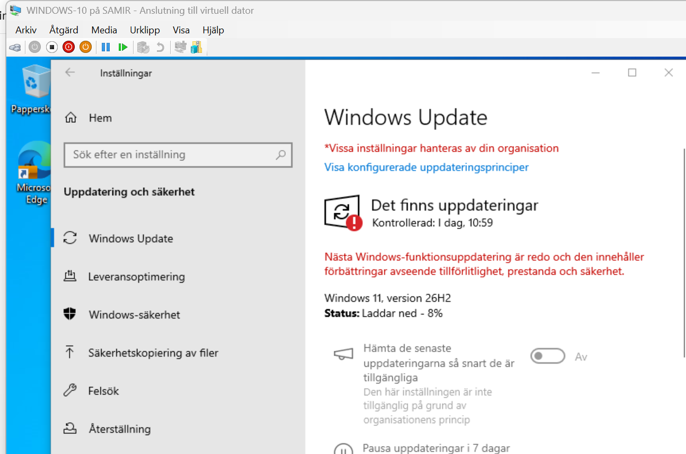
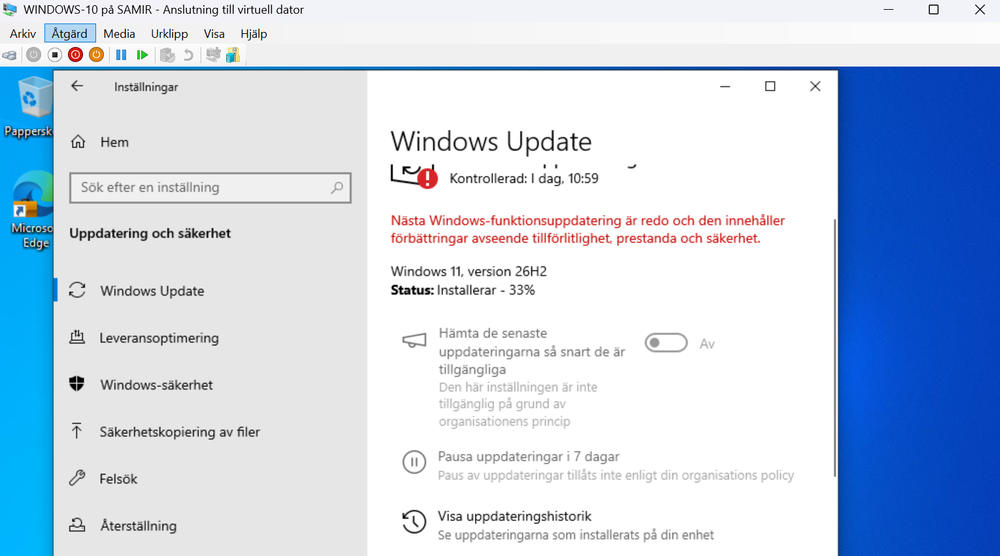

## 6. Result
- `ver` → **10.0.26300.9457** (Windows 11 26H2), same device name `LAB-46792`
- Update history: *Windows 11, version 26H2 – installed 2026-11-02*
- Intune device page: OS version 10.0.26300.9457, Enterprise, still enrolled by TestUser2 – no re-enrollment needed

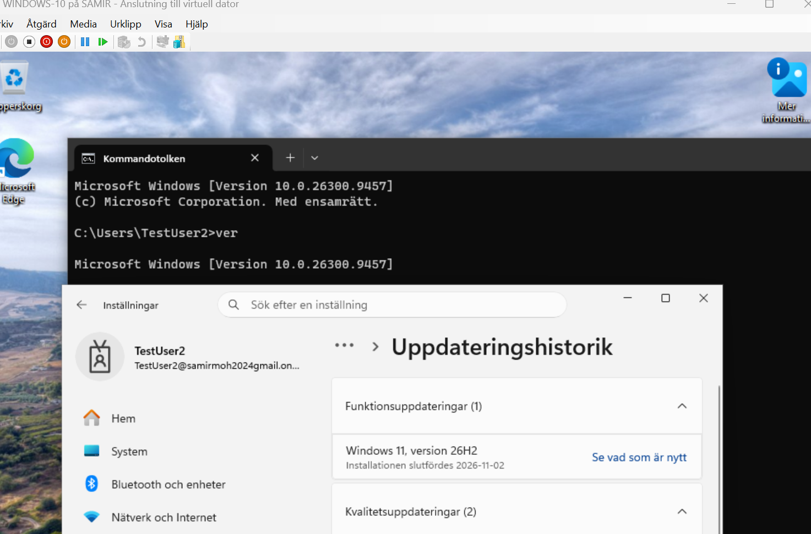
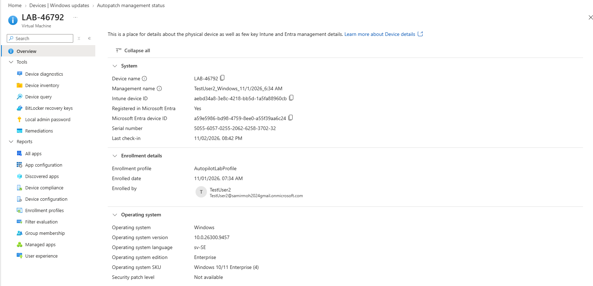
