# 11 – Microsoft Defender for Endpoint

**Goal:** manage Defender Antivirus from Intune, onboard the devices to Defender for Endpoint (EDR), enable tamper protection and verify detection with an EICAR test.

## 1. Antivirus policy
*Endpoint security → Antivirus → Create policy → Windows → Microsoft Defender Antivirus*

| Setting | Value |
|---|---|
| Name | Defender-AV-Lab |
| Real-time / behavior monitoring / cloud protection | Allowed |
| Cloud block level | High |
| PUA protection | On (block) |
| Submit samples consent | Send safe samples automatically |
| Assignment | SG-Autopilot-Devices-Lab |

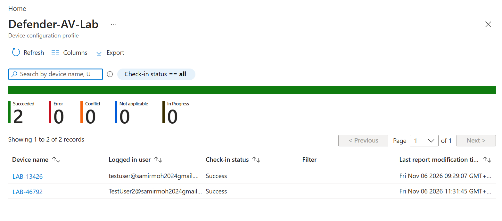
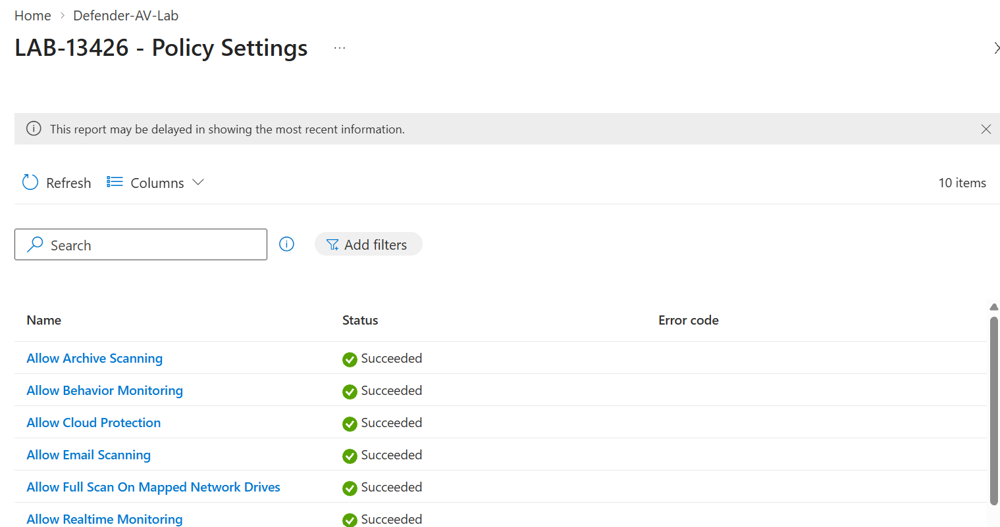
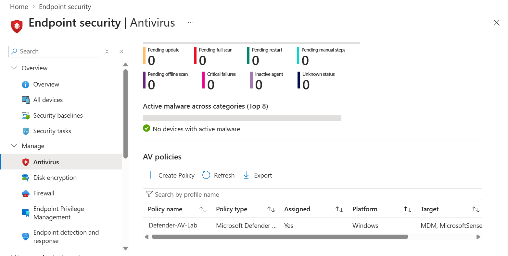

## 2. Verify on the clients
```powershell
Get-MpComputerStatus | Select AMRunningMode, AntivirusEnabled, RealTimeProtectionEnabled, IsTamperProtected
Get-MpPreference | Select DisableRealtimeMonitoring, MAPSReporting, CloudBlockLevel, PUAProtection
```

The first check showed `CloudBlockLevel 0` and `PUAProtection 2` (audit only), so the policy was weaker than intended. After adjusting it in Intune, both devices reported **CloudBlockLevel 2 (High)** and **PUAProtection 1 (Block)**.

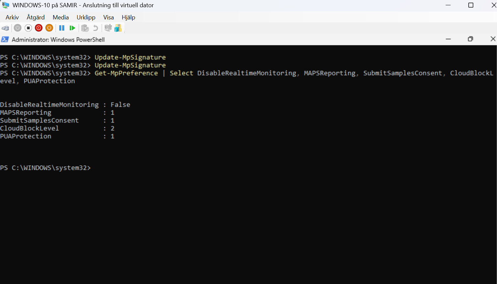
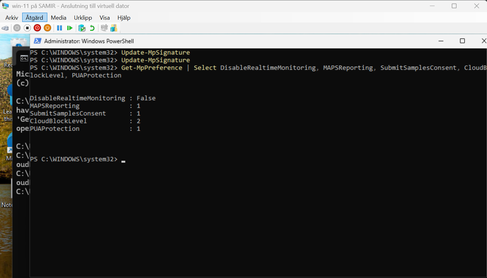

## 3. Connect Defender for Endpoint and Intune
1. **security.microsoft.com → Settings → Endpoints → Advanced features:** Microsoft Intune connection **On**, Tamper protection **On**, Save preferences.
2. **Intune → Endpoint security → Microsoft Defender for Endpoint:** *Connect Windows devices … to Microsoft Defender for Endpoint* **On**.


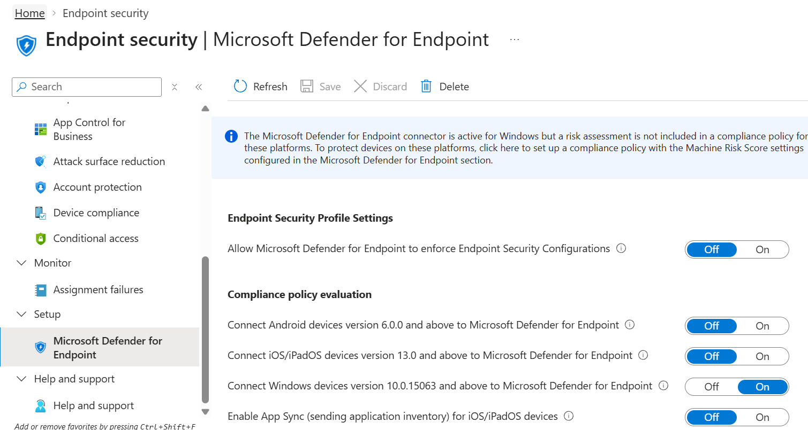

## 4. Onboard with an EDR policy
*Endpoint security → Endpoint detection and response → Create policy → Windows*

- Name: `EDR-Onboarding-Lab`
- Client configuration package type: **Auto from connector**
- Assignment: SG-Autopilot-Devices-Lab

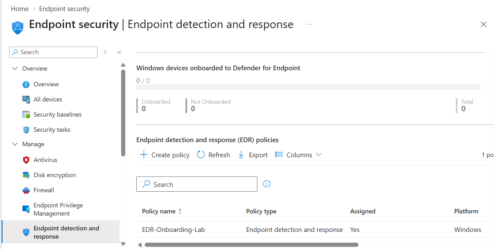
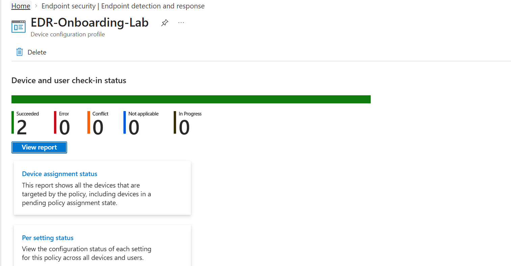

Verify on a client:
```powershell
Get-Service Sense | Select Status
(Get-ItemProperty "HKLM:\SOFTWARE\Microsoft\Windows Advanced Threat Protection\Status").OnboardingState   # 1
```

## 5. Tamper protection test
After onboarding, `IsTamperProtected` changed to **True**. Signed in as the LAPS-managed local admin, I tried to turn off real-time protection:

```powershell
Get-MpComputerStatus | Select IsTamperProtected        # True
Set-MpPreference -DisableRealtimeMonitoring $true      # no error...
Get-MpPreference | Select DisableRealtimeMonitoring    # ...but still False
```

Even a local administrator cannot switch Defender off. Settings can only be changed centrally.

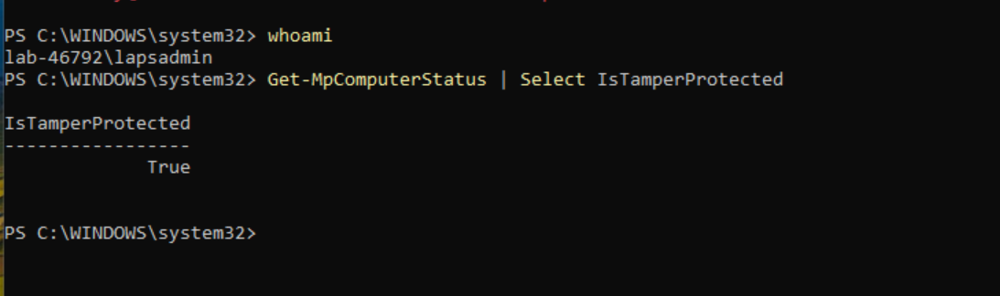
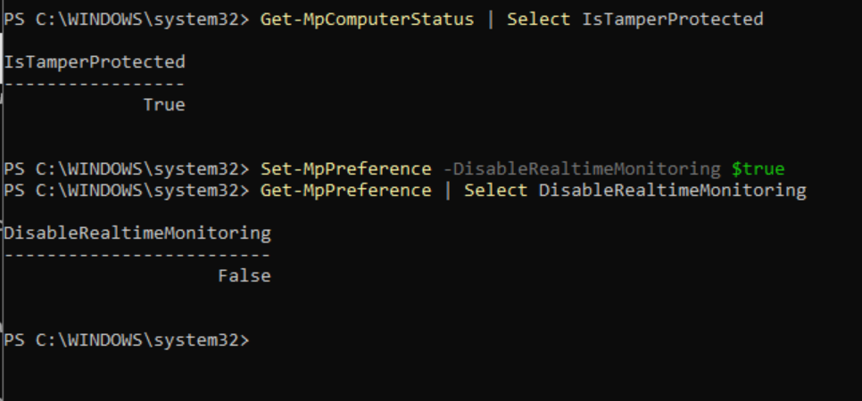

## 6. EICAR detection test
Created `EICAR.txt` with the standard harmless EICAR test string on LAB-46792.


- **Client:** Defender blocked the file immediately ("Threats found").
- **Defender portal:** alert *'EICAR_Test_File' malware was prevented* with the full process tree: device, user, `explorer.exe` → `Notepad.exe` → `EICAR.txt`. Severity Informational, status Prevented.

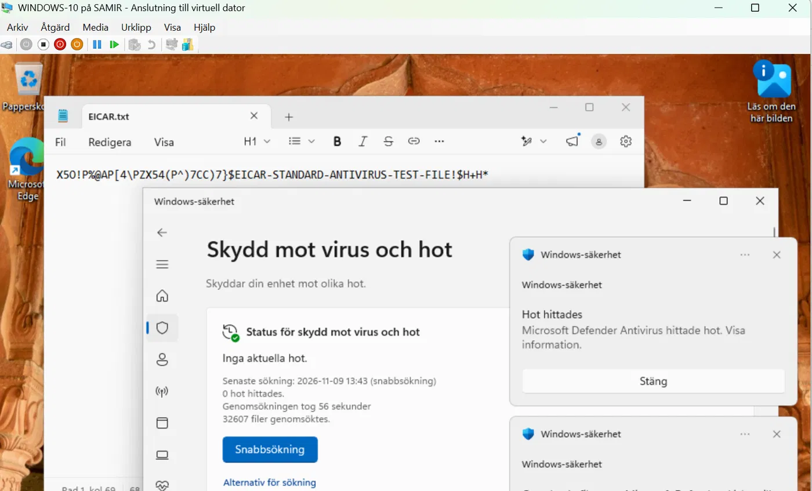
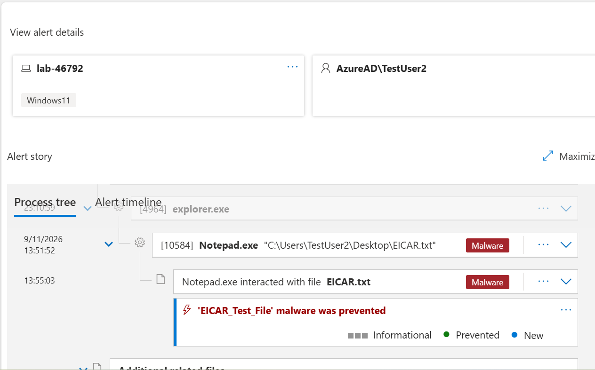

The alert was then triaged: classified as *True positive – security testing*, resolved with a comment.
