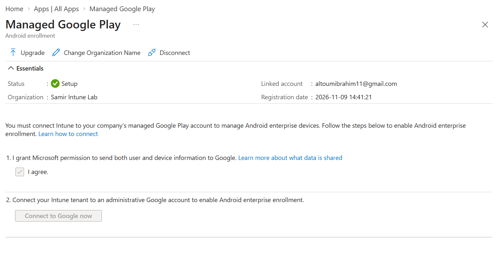
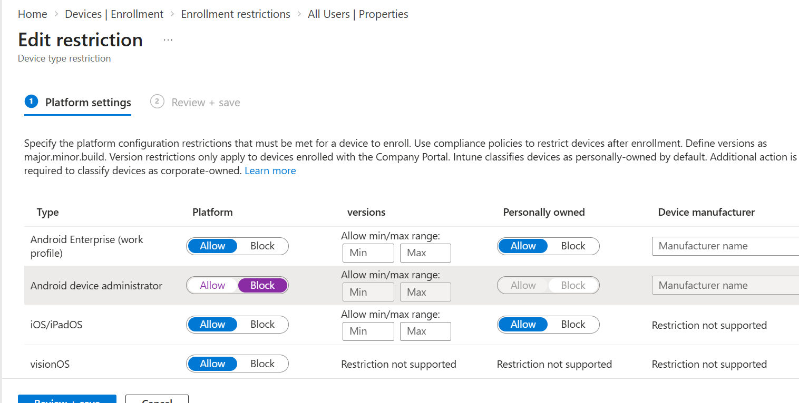
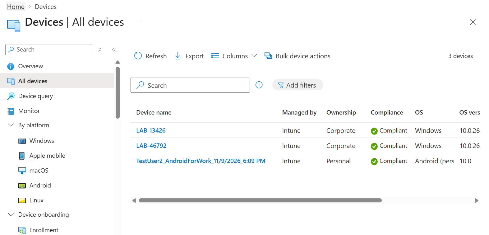

# 12 – Android Enterprise: personally-owned work profile

**Goal:** enroll a personal Android phone (BYOD) with a work profile, so IT manages only the work data.

## 1. Connect Managed Google Play
*Apps → Android → Create → Managed Google Play app* → I agree → **Connect to Google now** → **Sign up for Android only** → organization name *Samir Intune Lab*. The Data Protection Officer / EU representative fields can be left empty.

Status: **Setup**.

## 2. Enrollment settings
- *Devices → Enrollment → Android → Personally owned devices with work profile:* allowed via Company Portal (web-based enrollment not enabled).
- *Device platform restriction → Android → All Users:* **Android Enterprise (work profile) Allow**, personally owned **Allow**. **Android device administrator Block** (deprecated method).

## 3. Enroll the phone
Installed **Intune Company Portal** from Google Play, signed in with TestUser2 and accepted the work profile. Device: Huawei VOG-L29, Android 10.

## 4. Result
Three managed devices: two corporate Windows devices (Autopilot) and one **personal** Android device (work profile).

| | Corporate (Autopilot) | Personal (work profile) |
|---|---|---|
| IT can wipe | Whole device | Only the work profile (retire) |
| IT can see | Device and apps | Work apps and device basics, not private apps, photos or messages |

## Next steps
- Android compliance policy (screen lock, encryption, minimum OS version, block rooted devices)
- Deploy apps from Managed Google Play into the work profile
- App protection policies (block copy/paste from work apps to personal apps)
