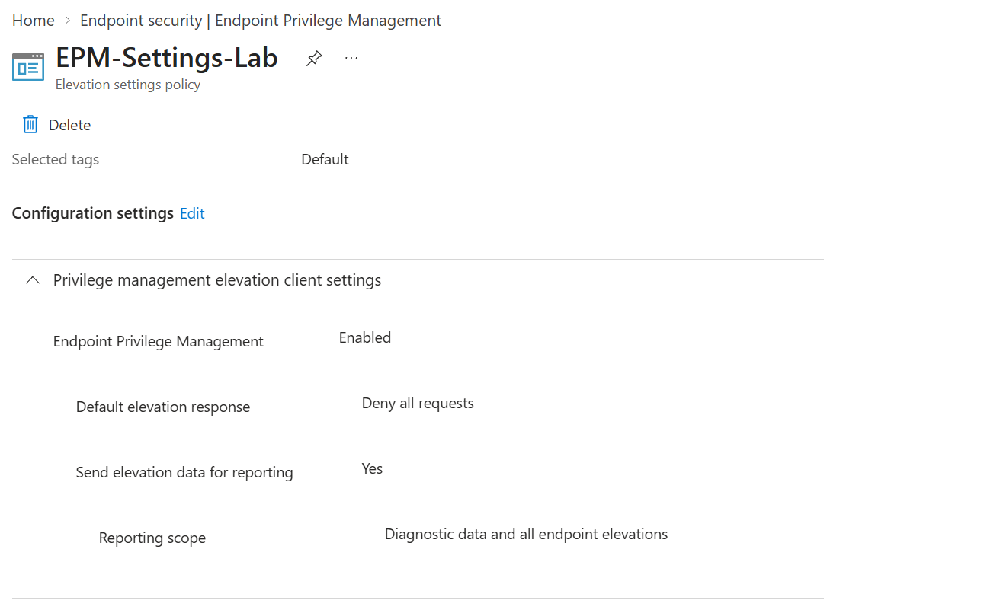
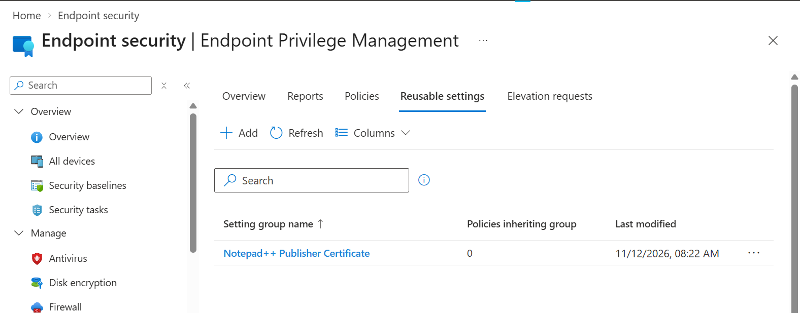
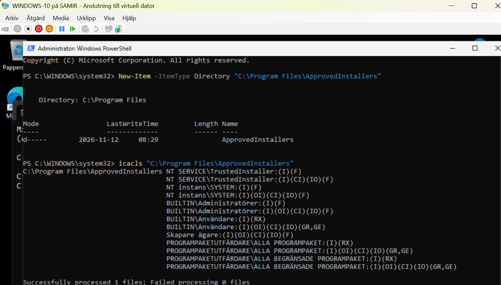
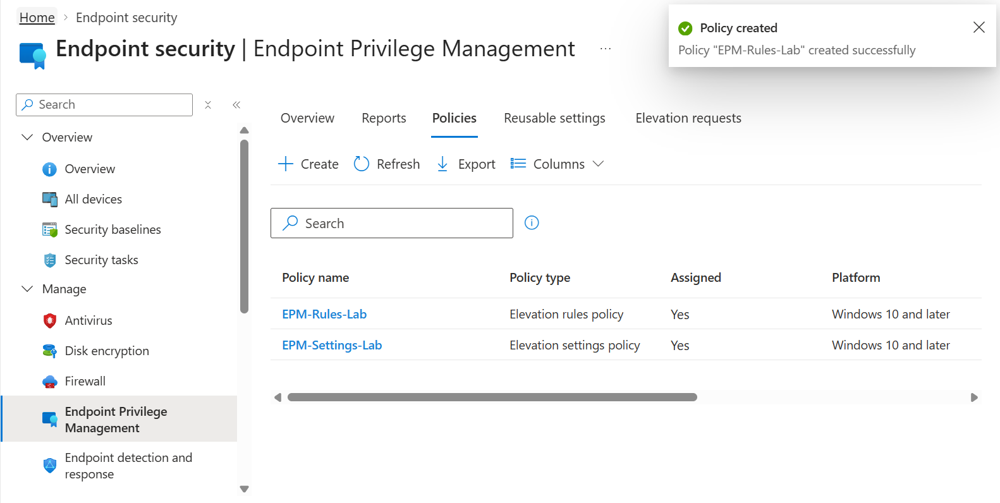
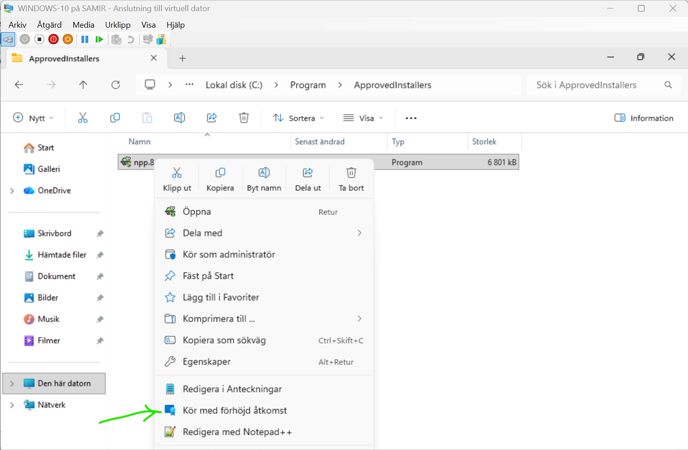
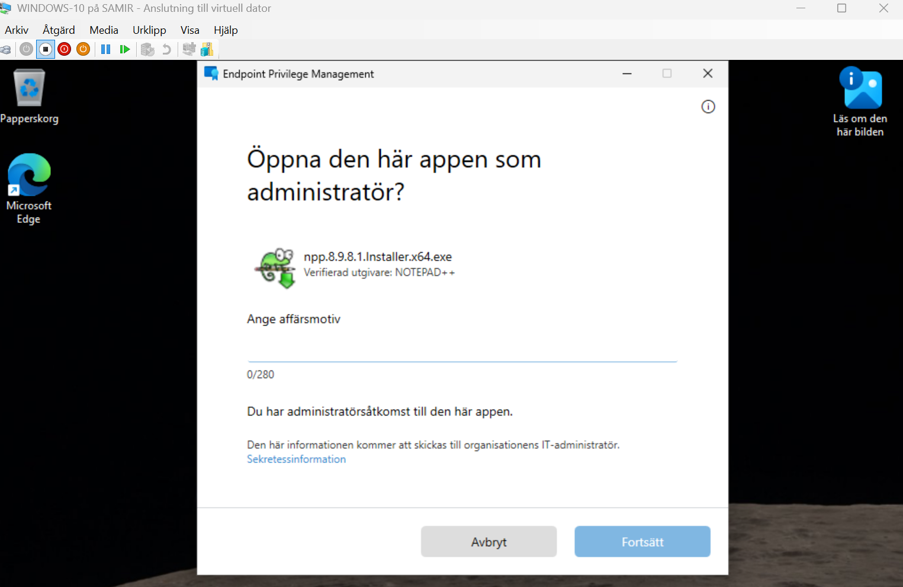
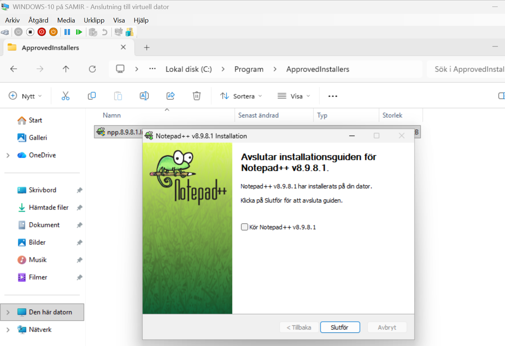
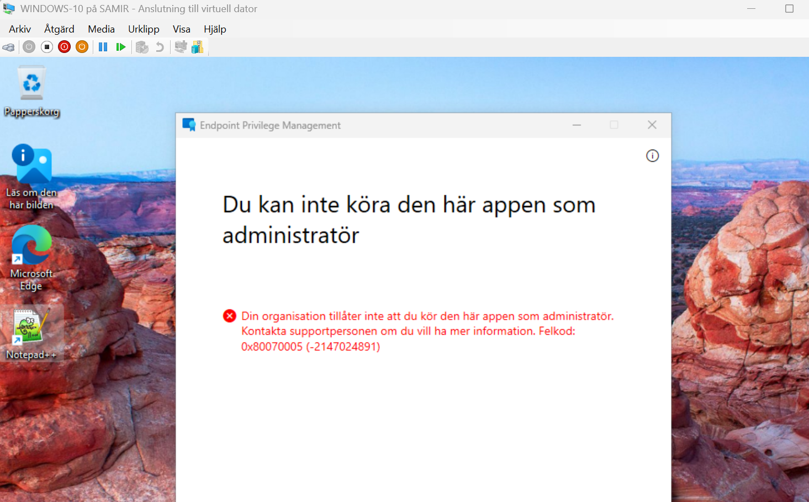

# 13 – Endpoint Privilege Management (EPM)

**Goal:** let standard users run approved installers with admin rights, without being local administrators and without an admin password.

EPM is part of the Intune Suite, which Microsoft 365 E5 includes since the July 2026 licensing update.

## 1. Elevation settings policy (turns EPM on)
*Endpoint security → Endpoint Privilege Management → Create → Windows → Elevation settings policy*

| Setting | Value |
|---|---|
| Name | EPM-Settings-Lab |
| Endpoint Privilege Management | Enabled |
| Default elevation response | **Deny all requests** |
| Send elevation data for reporting | Yes – diagnostic data and all endpoint elevations |
| Assignment | SG-Autopilot-Devices-Lab |



## 2. Certificate as a reusable setting
The Notepad++ installer is signed by the publisher (`CN=NOTEPAD++`):

```powershell
$file = "C:\Packaging\Source\NotepadPP\Files\npp.8.9.8.1.Installer.x64.exe"
Get-AuthenticodeSignature $file | Select Status          # Valid
$cert = (Get-AuthenticodeSignature $file).SignerCertificate
Export-Certificate -Cert $cert -FilePath C:\Packaging\Tools\NotepadPP-Publisher.cer
```

Uploaded under *Endpoint Privilege Management → Reusable settings*.



## 3. Protected folder for approved installers
A certificate rule alone would let a user rename any file signed by the same publisher. The rule is therefore locked to a folder that standard users cannot write to:

```powershell
New-Item -ItemType Directory "C:\Program Files\ApprovedInstallers"
icacls "C:\Program Files\ApprovedInstallers"   # BUILTIN\Users: (RX) only
```

The installer was copied in from the Hyper-V host with `Copy-VMFile` (requires the Guest services integration service).



## 4. Elevation rules policy
| Field | Value |
|---|---|
| Name | EPM-Rules-Lab |
| Rule name | Notepad++ – Publisher certificate |
| Elevation type | User confirmed (business justification) |
| File name | `npp.8.9.8.1.Installer.x64.exe` |
| File path | `C:\Program Files\ApprovedInstallers` |
| Signature source | Certificate in reusable settings, type Publisher |



### Hash vs certificate
| | File hash | Certificate + protected path |
|---|---|---|
| Matches | Exactly one file | All the publisher's files in that folder |
| New app version | Rule must be updated | Works automatically (until the certificate is renewed) |
| Risk | Lowest | Low, if the path is protected |

## 5. Test as standard user TestUser2
The context menu shows **Run with elevated access** (*Kör med förhöjd åtkomst*) next to the normal *Run as administrator*.



- **Approved installer in the protected folder:** justification entered → installed to `C:\Program Files` without an admin password.
- **App without a rule:** denied, error `0x80070005`.





